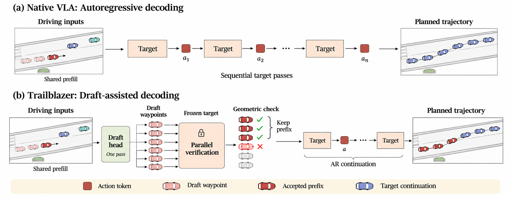
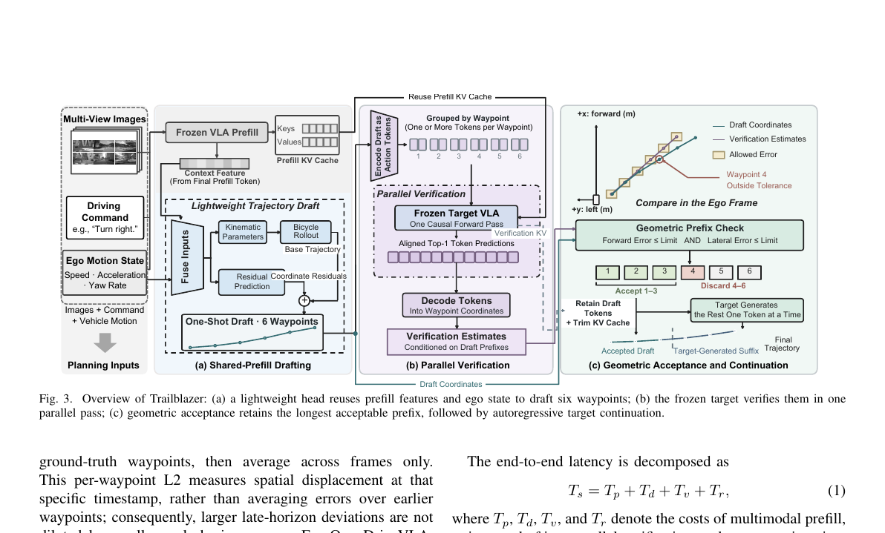

# Trailblazer-AD

Speculative trajectory decoding for autoregressive driving VLAs.
A lightweight draft head proposes waypoints; the frozen teacher verifies them in parallel and only AR-decodes the rejected suffix.

Paper: *Trailblazer: Speculative Trajectory Decoding for Faster Autoregressive Driving VLAs*

<p align="center">
  
</p>

<p align="center">
  
</p>

## Results (nuScenes val, live CUDA-sync)

| | OpenDriveVLA-0.5B | R&B-EnCoRe (Qwen3-VL-4B) |
|---|---|---|
| frames | 6015 | 6017 |
| mean accept / 6 | 4.42 | 4.14 |
| official `generate()` | 1611 ms | 2385 ms |
| Trailblazer E2E | 885 ms | 882 ms |
| **E2E speedup** | **1.82×** | **2.70×** |
| Teacher L2 1/2/3s (masked) | 0.58 / 0.82 / 0.96 | 0.24 / 0.49 / 0.84 |
| Spec L2 1/2/3s (masked) | 0.61 / 0.84 / 0.98 | 0.27 / 0.53 / 0.91 |

L2 uses OpenDrive-style `gt_ego_fut_masks` (invalid future steps contribute 0), so incomplete GT no longer produces ~10 m outliers. Raw JSONs: `results/live_specdec_opendrive_full_6019.json`, `results/live_waypoints_rnb_full_6019_rerun.json`; masked summaries: `results/live_*_masked.json`.

## Setup

```bash
# OpenDriveVLA env: torch 2.5 + transformers 4.57 + llava/mmengine
OD=/data2/conda_env/unidrivevla/bin/python
# R&B / Qwen3-VL env: transformers >= 5
RNB=/data2/conda_env/qwendrive/bin/python

export TRAJSPEC_OPENDRIVE_CKPT=/path/to/OpenDriveVLA-0.5B
export TRAJSPEC_OPENDRIVE_REPO=/path/to/OpenDriveVLA
export TRAJSPEC_RNB_CKPT=/path/to/nuscenes-waypoints-model
export TRAJSPEC_NUSC_ROOT=/path/to/nuscenes
```

Draft heads ship in `weights/` (`draft_opendrive_nusc.pt`, `draft_waypoints_nusc.pt`).

## Run

**OpenDrive — dual-GPU full val (recommended)**

```bash
bash scripts/run_od_full_2gpu.sh
# shards → results/live_od_full_shard{0,1}.json
# merged → results/live_specdec_opendrive_full_6019.json
```

**OpenDrive — small smoke (matches paper latency protocol)**

```bash
CUDA_VISIBLE_DEVICES=0 $OD scripts/run_live_specdec_opendrive.py \
  --n 40 --warmup 2 --start 1500 --out results/live_od_smoke.json
```

**R&B — dual-GPU full val**

```bash
CUDA_VISIBLE_DEVICES=0 $RNB scripts/run_live_specdec_rnb.py \
  --n 3010 --warmup 2 --stride 1 --shard 0 --num-shards 2 \
  --ckpt weights/draft_waypoints_nusc.pt --out results/rnb_shard0.json &
CUDA_VISIBLE_DEVICES=1 $RNB scripts/run_live_specdec_rnb.py \
  --n 3010 --warmup 2 --stride 1 --shard 1 --num-shards 2 \
  --ckpt weights/draft_waypoints_nusc.pt --out results/rnb_shard1.json &
wait
$RNB scripts/merge_live_rnb_shards.py results/rnb_shard0.json results/rnb_shard1.json \
  --out results/live_waypoints_rnb_full_6019_rerun.json
```

**Re-score an existing live JSON with GT masks (no GPU)**

```bash
$RNB scripts/summarize_live_masked.py results/live_specdec_opendrive_full_6019.json \
  --out results/live_od_full_6019_masked.json
```

Use an **exclusive** free GPU for latency numbers. CUDA faults abort and checkpoint (`--save-every`); resume with `--resume`.

## Layout

```
trajspec/     draft head, geometric accept, live adapters, masked L2 metrics
scripts/      live eval, dual-GPU launchers, merge + masked summarize
weights/      trained draft heads
docs/figures/ paper figures used above
results/      live JSON outputs
```
